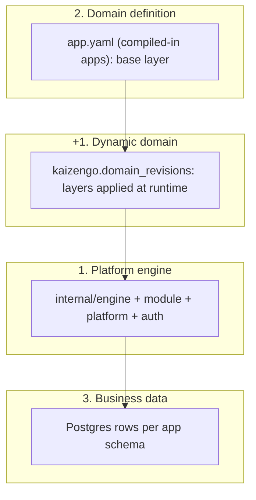
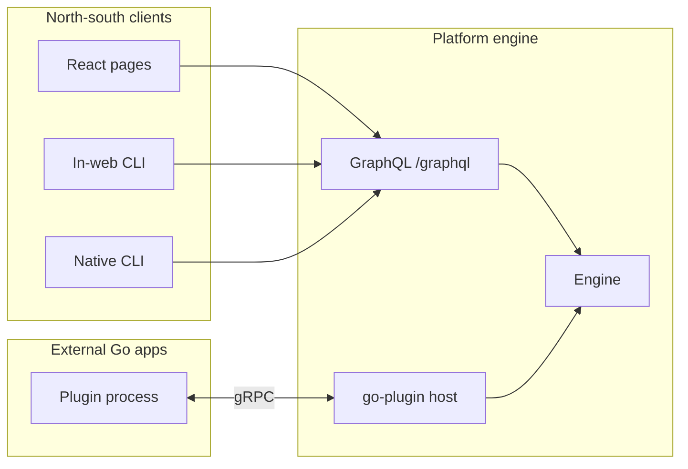

# Architecture

KaizenGo is an Enterprise Operations Platform built as **3+1 backend layers** with **GraphQL-first clients** and a **gRPC lane for external Go apps**. This page is the canonical map; [Internals](internals/index.md) goes deeper into process wiring.

## Backend: 3+1 layers



| Layer | What it is | Where it lives |
|-------|------------|----------------|
| **1. Platform engine** | Runs the system and applies domain logic: CQRS queries/commands, model CRUD, hooks, ACL, install, search | `internal/engine`, `internal/module`, `internal/platform`, `internal/auth` |
| **2. Domain definition** | Spec-driven definitions: entities (models), fields, queries, commands, policies, menus | `apps/<name>/app.yaml` (+ `models/*/spec.yaml`, `security.yaml`), parsed by `packages/sdk-go/appspec` |
| **3. Business data** | Records managed through commands and queries | Postgres tables in the app schema, read/written only through the engine |
| **+1. Dynamic domain** | The same domain definition as layer 2, stacked on top of it at runtime | `kaizengo.domain_revisions`, applied through the domain API (GraphQL or gRPC) |

**Apps categorize domain and data.** An app is a namespace (`hellospec`, `crm`, …) that groups models, queries, commands, policies, and their schema. It is not a separate layer: a compiled-in app and a dynamic app are the same thing to the engine; only the source of the base differs.

### One domain pipeline: base plus layers

Every app's domain is resolved the same way (`internal/engine/domains.go`):

```text
effective spec = base layer  +  stored layer (head of the overlay revisions)
                 │                │
                 │                └─ applied at runtime: domain apply / add-field / revert / import, plugins
                 └─ compiled app: app.yaml from code, recorded as a base revision when it changes
                    dynamic app:  empty (the stored layer is the whole definition)
```

- **Boot.** `engine.NewDomains` is provided before `module.Load`. Each compiled app's `Setup` reads its spec from code, records it as a `base` revision when it differs from the last one, merges the head `overlay` revision onto it (`appspec.Merge`), and mounts the result. `Domains.LoadAll` then mounts apps that only have stored layers. A layer that no longer fits a changed base is reported on the app (`error`) and skipped; the base still mounts.
- **Apply.** `platformApplyDomain` takes the complete effective document (what `domain show` prints). For a compiled app the engine subtracts the base (`appspec.Subtract`) and stores only the additions as the new layer; removing or changing anything the base defines is rejected. For a dynamic app the document is the layer.
- **Hot mount.** The spec-driven surface of a mounted app (model services, tables, CRUD/CQRS GraphQL fields, ACL resources, policies) is swapped in place: the fields the app's spec registered are removed and re-registered from the new spec, model services are replaced inside the same `ModelRegistry`, and on any failure the previous surface is restored. Go code (`Options.Setup`/`Mount`, hooks, handlers, nav, locales) is not re-run. Compiled apps that are not installed get the layer when they are installed.
- **DDL is additive.** New tables and columns are created (`CREATE TABLE IF NOT EXISTS`, `ADD COLUMN IF NOT EXISTS`); nothing is dropped or retyped, so data survives removing a field or reverting. Compiled apps keep their migrations for base tables; only tables/columns a layer adds are generated.
- **Policies.** Layer policy entries are applied on mount; entries a new revision no longer declares are disabled.

### Revisions, revert, backup, restore

`kaizengo.domain_revisions` is append-only: `(app, revision)` with `layer` (`base` or `overlay`), the stored document, `source` (`compiled`, `graphql`, `plugin:<name>`, `revert:<n>`, `restore`), and the computed change list. Revision numbers are per app and shared by both layers.

| Operation | Effect |
|-----------|--------|
| Apply / add-field | New overlay revision with the new layer |
| Revert to *n* | New overlay revision holding the layer as it was at *n* (base stays the running code) |
| Delete | New overlay revision with an empty layer: a compiled app falls back to its base, a dynamic app is unmounted (tables and history kept, so it can be reverted) |
| Export | YAML bundle (`kind: kaizengo.domains/v1`) with each app's current layer |
| Import | Each bundle entry is validated, then applied as a new revision (source `restore`); apps not in the bundle are untouched |

Rejected at apply time:

- For dynamic apps: reserved names (`core`, `apps`, `platform`, `kaizengo`, `public`), file includes, nav/menus, locales, `extends`/`exports`, and a `schema` different from the name.
- For compiled apps: removing or changing a model, field, query, command, role, or policy entry the base defines; changing model flags (`internal`, `virtual`) or base search settings.
- Field type changes on existing models (add a new field instead).
- Documents larger than 256 KiB.
- Any GraphQL root field another app already defines (for example an app `search` with a `backend` query would shadow `searchBackend`).

## API surfaces



| Surface | Who uses it | What it carries |
|---------|-------------|-----------------|
| **GraphQL** (`/graphql`) | React SPA, in-web CLI, native CLI, external non-Go tools | Business data (CQRS fields), domain definition (`platform*` meta fields), catalog, shell |
| **gRPC** (hashicorp/go-plugin) | External **Go** apps only | Domain definitions, Go hooks, query/command handlers, platform services those hooks call (auth, ACL/policies, records) |

Rule: **everything except Go hooks/handlers must be possible through GraphQL**, so the CLI and non-Go tooling are first-class. gRPC exists because Go code has to run somewhere; it is never used by the browser or the CLI.

### GraphQL platform meta surface

| Field | Kind | Purpose | ACL resource |
|-------|------|---------|--------------|
| `platformDomains(kind)` | query | Every app's domain (`kind`: `compiled` or `dynamic` filters) | `platform.api.domain` read |
| `platformDomain(app)` | query | Effective document (`spec`), stored layer (`layer`), base/layer revisions, load state | `platform.api.domain` read |
| `platformDomainRevisions(app)` / `platformDomainRevision(app, revision)` | query | Revision history / one stored revision | `platform.api.domain` read |
| `platformDomainDiff(spec)` | query | Changes a document would make | `platform.api.domain` read |
| `platformApplyDomain(spec, dryRun)` | mutation | Validate, migrate, store a layer revision, hot-mount | `platform.api.domain` create/update |
| `platformRevertDomain(app, revision, dryRun)` | mutation | Re-apply the layer as of a revision | `platform.api.domain` update |
| `platformDeleteDomain(app, dryRun)` | mutation | Empty layer: reset a compiled app, unmount a dynamic app (data and history kept) | `platform.api.domain` delete |
| `platformExportDomains(apps)` / `platformImportDomains(bundle, dryRun)` | query / mutation | Back up / restore current layers | read / create+update |
| `platformCatalog(app)` | query | Callable queries/commands with args and return shape, filtered by ACL | signed-in user |
| `platformPlugins` | query | Loaded gRPC plugins, their apps, hooks, handlers | `platform.api.plugins` read |
| `platformShell(line)` | mutation | Run one CLI command line (see below) | signed-in user; each inner operation is ACL-checked |

Business data stays on the per-app CQRS fields (`hellospecGreetings`, `hellospecPostGreeting`, …).

`platformCatalog` is what makes every operation reachable by name. It lists:

- Spec operations of every loaded app (CQRS queries/commands, or `listX`/`getX`/`createX`/… for model-CRUD apps), filtered by the caller's ACL.
- All other root fields. Fields with an app's prefix are attributed to that app (`crmLeadsCount` → `crm.leadsCount`, `identityMenus` → `identity.menus`). The rest (`settings`, `updateSettings`, `search`, view presets, `platform*`) are listed under the pseudo-app `graphql`. These resolvers enforce access themselves, so they are listed without a catalog ACL check.

## Frontends

The backend ships two frontends by default; both use GraphQL only.

1. **React pages** — `apps/core/spa` shell plus `apps/<name>/views/*.page.tsx` (see [React SPA](internals/solid-sdk.md)).
2. **In-web CLI** — a command palette and a terminal panel in the shell.

### How the CLI works

The command grammar is implemented once, on the server (`internal/shell`), and exposed through `platformShell(line)`. Every client — web terminal, command palette, and the native `kaizen` binary — sends lines and prints the result. Each command maps to GraphQL operations executed against the live schema with the caller's session, so ACL is enforced exactly as for the SPA.

| Command | Does |
|---------|------|
| `help [command]` | Command reference |
| `whoami` | Current user and org |
| `apps` | Apps with callable operations |
| `ls [app]` | Queries and commands (from `platformCatalog`) |
| `describe <app.op>` | Args and return fields |
| `query <app.op> [key=value …]` | Run a query |
| `run <app.op> [key=value …]` | Run a command |
| `domain list` / `show <app> [--layer \| --rev N]` / `history <app>` | Domains, their layers, and revisions |
| `domain apply [--dry-run] <<EOF … EOF` / `add-field …` | Apply a domain document or add one field (any app) |
| `domain diff <<EOF … EOF` | Preview changes |
| `domain revert <app> <rev>` / `delete <app>` | Re-apply an earlier layer / drop the layer (data kept) |
| `domain export [app …]` / `import <<EOF … EOF` | Back up / restore layers |
| `plugins` | Loaded gRPC plugins |
| `gql <document>` | Raw GraphQL (power users) |

Values are coerced by the argument's GraphQL type (`count=3`, `done=true`, `tags=a,b` or `tags=["a","b"]`, input objects as JSON); quote values with spaces (`message="hello world"`).

The **command palette** (`Alt+K`) lists catalog operations and shell commands; picking one either runs it or opens the **terminal** (`Alt+T`) pre-filled. The **native CLI** (`kaizen`) logs in with email/password, keeps the session cookie, and speaks the same `platformShell` mutation — see [CLI](cli.md).

## External Go apps (gRPC)

An external app is a separate Go binary served with hashicorp/go-plugin. At boot the host launches each binary listed in `KaizenGo_PLUGINS`, and the plugin:

1. **Describes itself** — name, version, optional domain document, hook bindings, handler names.
2. **Provides domain definitions** — applied through the same domain pipeline (source `plugin:<name>`).
3. **Registers Go hooks** — bound as extension handlers on model points (`model.<app>.<model>.beforeCreate`, …), for its own apps or any other app; the host calls the plugin over gRPC.
4. **Implements handlers** — queries/commands declared without `list`/`create`/… shorthand.
5. **Calls platform services** from hooks through the host broker: `Authorize` (ACL/policy evaluation), `Principal`, record `Get`/`List`/`Create`/`Update`/`Delete`, and domain `Apply`/`Get`.

A plugin that fails to start or apply its domains is recorded with its error in `platformPlugins` and does not stop the platform. Plugin hooks and handlers are unbound and the processes are killed when the platform shuts down (including database switches).

Details and the protobuf contract: [gRPC plugins](grpc-plugins.md).

## Decisions

- CLI clients (web and native) talk **only GraphQL**; they never use gRPC.
- Compiled and dynamic apps go through one pipeline: base layer (code or empty) plus stored layer revisions, hot-mounted; no separate metamodel.
- Domain revisions are append-only, so every change can be reverted, exported, and restored.
- Generated DDL is additive only; redefinition never drops business data.
- Go hooks and handlers are the only capability that requires gRPC; every other operation (domain, data, install, policies already modeled as data) is reachable from GraphQL.
- The shell grammar lives on the server so every client shares it.
- In-process compiled-in apps (`blank-import` + `module.Register`) remain the default; plugins and dynamic apps are additional load paths.
- The UI is React; there is no event store (direct SQL writes through the engine).
