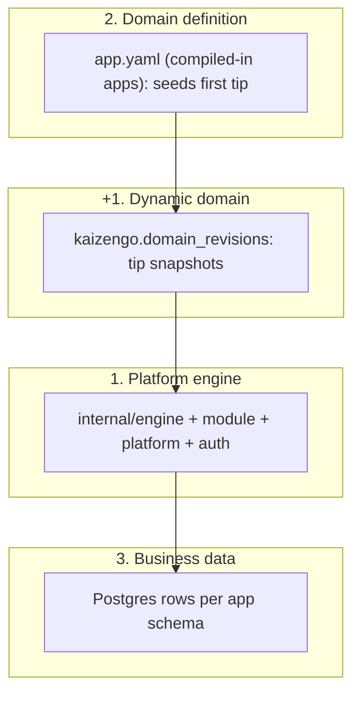
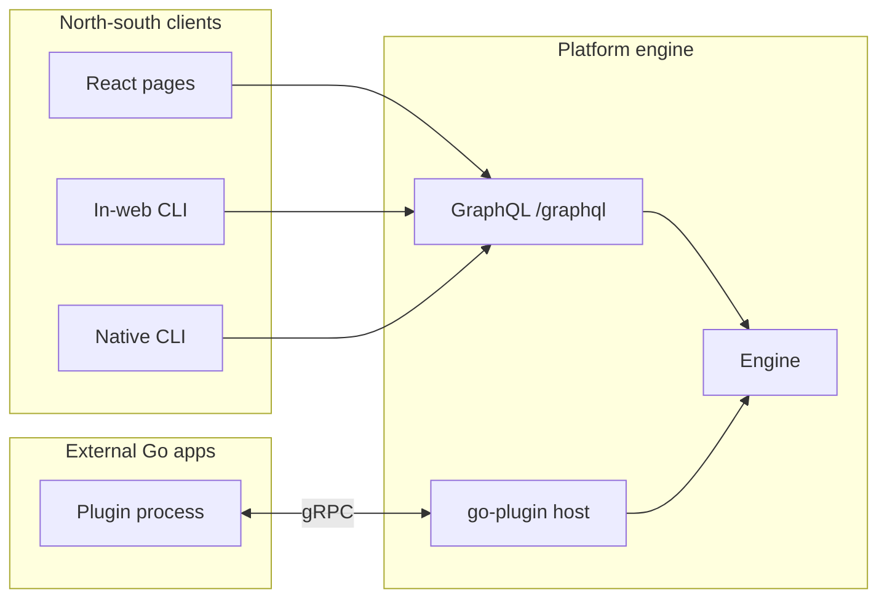

# Architecture

KaizenGo is an Enterprise Operations Platform built as **3+1 backend layers** with **GraphQL-first clients** and a **gRPC lane for external Go apps**. This page is the canonical map; [Internals](internals/index.md) goes deeper into process wiring.

## Backend: 3+1 layers



| Layer | What it is | Where it lives |
|-------|------------|----------------|
| **1. Platform engine** | Runs the system and applies domain logic: CQRS queries/commands, model CRUD, hooks, ACL, install, search | `internal/engine`, `internal/module`, `internal/platform`, `internal/auth` |
| **2. Domain definition** | Spec-driven definitions: entities (models), fields, queries, commands, policies, menus | `apps/<name>/app.yaml` (+ `models/*/spec.yaml`, `security.yaml`), parsed by `packages/sdk-go/appspec` |
| **3. Business data** | Records managed through commands and queries | Postgres tables in the app schema, read/written only through the engine |
| **+1. Dynamic domain** | The same domain definition as layer 2, as git-like tip revisions applied at runtime | `kaizengo.domain_revisions`, applied through the domain API (GraphQL or gRPC) |

**Apps categorize domain and data.** An app is a namespace (`hellospec`, `crm`, …) that groups models, queries, commands, policies, and their schema. Compiled-in and dynamic apps use one pipeline; only how the first tip is seeded differs.

### One domain pipeline: tip revisions (git-like)

Every app's domain is the **tip revision** — a full effective document (`internal/engine/domains.go`):

```text
tip revision = full AppSpec snapshot (git commit analogy)
                 │
                 ├─ compiled: first tip from app.yaml (source=compiled); runtime apply/set/remove append tips
                 └─ dynamic: empty until first apply; then full snapshots
```

- **Boot.** `engine.NewDomains` is provided before `module.Load`. Each compiled app's `Setup` ensures a tip exists from code when needed, then mounts the tip document (full snapshot, or a legacy overlay merged onto code). `Domains.LoadAll` mounts apps that only have stored tips. If code `app.yaml` changed under a tip that already has runtime edits, the engine runs a **three-way merge** (ancestor = last `compiled`/`rebase` tip, ours = current tip, theirs = new code). Untouched paths auto-take code; only paths both sides changed become conflicts. Clean → append tip `source=rebase` and mount. Conflicts → **keep the old tip mounted**, stash incoming code as pending (not tip), set `rebaseStatus=conflict`. Resolve in **Settings → Domains** (per-path tip vs code), or `domain rebase <app>` / `--force` (code wins every conflict). `platformRebaseDomain` accepts `resolutions: [{path, side}]`. Data-migration gates return structured `migrateHints` + `proposedSpec` for the Domains migrate wizard. Revert to any prior revision remains available.

- **Apply.** `platformApplyDomain` takes the complete effective document (what `domain show` prints) and stores it as the next tip. Compiled-origin entities may be overridden (edit HelloSpec `GreetingForm`, remove a field from the API, etc.). Helpers (`add-field` / `set-view` / `remove-field`, …) patch the tip and apply.
- **Soft vs `--force`.** Default side effects stay additive: omit a field/index/relation from the tip and GraphQL, but keep Postgres columns/indexes/junctions. With `force: true` / `--force`, removed objects are `DROP`ped when safe; type rewrites are allowed in the changelog and columns are dropped/recreated.
- **Hot mount.** The spec-driven surface of a mounted app is swapped in place; on failure the previous surface is restored. Go code (`Options.Setup`/`Mount`, hooks, handlers) is not re-run.
- **DDL.** Soft apply: `CREATE TABLE IF NOT EXISTS`, `ADD COLUMN IF NOT EXISTS` only. Force: explicit `DROP INDEX` / `DROP TABLE` junction / `DROP COLUMN`. Compiled apps keep migrations for code tables; the engine still creates indexes and junction tables for the tip.
- **Data migrate.** Tip changes that add/remove/retype stored fields require `--migrate-pre=SQL`, `--migrate=SQL` (post), `--migrate-go <name>` (compiled `RegisterDomainMigration`), or `--no-migrate`. Order: migrate-pre → additive DDL → migrate-post / Go → force drops. `set-field --name` defaults to a pre `RENAME COLUMN`. View-only tip edits skip this gate.
- **Policies.** Tip policy entries are applied on mount; entries a new revision no longer declares are disabled.

### Revisions, revert, backup, restore

`kaizengo.domain_revisions` is append-only: `(app, revision)` with the full tip document, `source` (`compiled`, `graphql`, `plugin:<name>`, `revert:<n>`, `restore`), and the computed change list. New writes use layer label `revision` (legacy rows may still say `base` / `overlay`).

| Operation | Effect |
|-----------|--------|
| Apply / add-* / set-* / remove-* | New tip revision (full snapshot) |
| Revert to *n* | New tip equal to the document at *n* (history stays append-only) |
| Delete | Soft-clear tip: compiled remounts code; dynamic unmounts (tables and history kept) |
| Export | YAML bundle (`kind: kaizengo.domains/v1`) with each runtime tip |
| Import | Each bundle entry is validated, then applied as a new tip (source `restore`) |

Rejected at apply time:

- For dynamic apps: reserved names (`core`, `apps`, `platform`, `kaizengo`, `public`), file includes, Go hook `extends`, compiled React `exports.components` / `exports.views`, `virtual` models (they need `RegisterModel`), and a `schema` different from the name.
- Field type changes without `--force` (add a new field instead, or pass `--force`).
- Documents larger than 256 KiB.
- Any GraphQL root field another app already defines.

## API surfaces



| Surface | Who uses it | What it carries |
|---------|-------------|-----------------|
| **GraphQL** (`/graphql`) | React SPA, in-web CLI, native CLI, external non-Go tools | Business data (CQRS fields), domain definition (`platform*` meta fields), catalog, shell |
| **gRPC** (hashicorp/go-plugin) | External **Go** apps only | Domain definitions, Go hooks, query/command handlers, platform services those hooks call (auth, ACL/policies, records) |

Rule: **everything except Go hooks/handlers must be possible through GraphQL**, so the CLI and non-Go tooling are first-class. gRPC exists because Go code has to run somewhere; it is never used by the browser or the CLI.

### GraphQL platform meta surface

| Field | Kind | Purpose | ACL resource |
|-------|------|---------|--------------|
| `platformDomains(kind)` | query | Every app's domain (`kind`: `compiled` or `dynamic` filters) | `platform.api.domain` read |
| `platformDomain(app)` | query | Tip document (`spec`), revision, load state | `platform.api.domain` read |
| `platformDomainRevisions(app)` / `platformDomainRevision(app, revision)` | query | Revision history / one stored revision | `platform.api.domain` read |
| `platformDomainDiff(spec)` | query | Changes a document would make | `platform.api.domain` read |
| `platformApplyDomain(spec, dryRun, force)` | mutation | Validate, migrate, store a tip snapshot, hot-mount (`force` drops removed DDL) | `platform.api.domain` create/update |
| `platformDomainConflicts(app)` | query | Pending tip-vs-code conflict paths | `platform.api.domain` read |
| `platformRebaseDomain(app, force, dryRun)` | mutation | Three-way merge tip onto pending/current code | `platform.api.domain` update |
| `platformRevertDomain(app, revision, dryRun)` | mutation | Append a tip equal to that revision | `platform.api.domain` update |
| `platformDeleteDomain(app, dryRun)` | mutation | Soft-clear tip: remount compiled from code, unmount dynamic (data and history kept) | `platform.api.domain` delete |
| `platformExportDomains(apps)` / `platformImportDomains(bundle, dryRun)` | query / mutation | Back up / restore tip snapshots | read / create+update |
| `platformCatalog(app)` | query | Callable queries/commands with args and return shape, filtered by ACL | signed-in user |
| `platformPlugins` | query | Loaded gRPC plugins, their apps, hooks, handlers | `platform.api.plugins` read |
| `platformShell(line)` | mutation | Run one CLI command line (see below) | signed-in user; each inner operation is ACL-checked |

Business data stays on the per-app CQRS fields (`hellospecGreetings`, `hellospecPostGreeting`, …).

`platformCatalog` is what makes every operation reachable by name. It lists:

- Spec operations of every loaded app (CQRS queries/commands, or `listX`/`getX`/`createX`/… for model-CRUD apps), filtered by the caller's ACL.
- All other root fields. Fields with an app's prefix are attributed to that app (`crmLeadsCount` → `crm.leadsCount`, `identityMenus` → `identity.menus`). The rest (`settings`, `updateSettings`, `search`, view presets, `platform*`) are listed under the pseudo-app `graphql`. These resolvers enforce access themselves, so they are listed without a catalog ACL check.

## Frontends

The backend ships two frontends by default; both use GraphQL only.

1. **React pages** — `apps/core/spa` shell plus `apps/<name>/views/*.page.tsx` (see [React SPA](internals/solid-sdk.md)).
2. **In-web CLI** — a command palette and a terminal panel in the shell.

### How the CLI works

The command grammar is implemented once, on the server (`internal/shell`), and exposed through `platformShell(line)`. Every client — web terminal, command palette, and the native `kaizen` binary — sends lines and prints the result. Each command maps to GraphQL operations executed against the live schema with the caller's session, so ACL is enforced exactly as for the SPA.

| Command | Does |
|---------|------|
| `help [command]` | Command reference |
| `whoami` | Current user and org |
| `apps` | Apps with callable operations |
| `ls [app]` | Queries and commands (from `platformCatalog`) |
| `describe <app.op>` | Args and return fields |
| `query <app.op> [key=value …]` | Run a query |
| `run <app.op> [key=value …]` | Run a command |
| `domain list` / `show <app> [--rev N]` / `history <app>` | Domains and tip revisions |
| `domain conflicts <app>` / `rebase <app> [--force]` | Upgrade conflicts / three-way merge onto pending code |
| `domain apply [--dry-run] [--force] <<EOF … EOF` / `add-*` / `set-*` / `remove-*` | Apply a tip snapshot, or patch then apply |
| `domain diff <<EOF … EOF` | Preview changes |
| `domain revert <app> <rev>` / `delete <app>` | Restore an earlier tip / soft-clear tip (data kept) |
| `domain export [app …]` / `import <<EOF … EOF` | Back up / restore tips |
| `plugins` | Loaded gRPC plugins |
| `gql <document>` | Raw GraphQL (power users) |

Values are coerced by the argument's GraphQL type (`count=3`, `done=true`, `tags=a,b` or `tags=["a","b"]`, input objects as JSON); quote values with spaces (`message="hello world"`).

The **command palette** (`Alt+K`) lists catalog operations and shell commands; picking one either runs it or opens the **terminal** (`Alt+T`) pre-filled. The **native CLI** (`kaizen`) logs in with email/password, keeps the session cookie, and speaks the same `platformShell` mutation — see [CLI](cli.md).

## External Go apps (gRPC)

An external app is a separate Go binary served with hashicorp/go-plugin. At boot the host launches each binary listed in `KaizenGo_PLUGINS`, and the plugin:

1. **Describes itself** — name, version, optional domain document, hook bindings, handler names.
2. **Provides domain definitions** — applied through the same domain pipeline (source `plugin:<name>`).
3. **Registers Go hooks** — bound as extension handlers on model points (`model.<app>.<model>.beforeCreate`, …), for its own apps or any other app; the host calls the plugin over gRPC.
4. **Implements handlers** — queries/commands declared without `list`/`create`/… shorthand.
5. **Calls platform services** from hooks through the host broker: `Authorize` (ACL/policy evaluation), `Principal`, record `Get`/`List`/`Create`/`Update`/`Delete`, and domain `Apply`/`Get`.

A plugin that fails to start or apply its domains is recorded with its error in `platformPlugins` and does not stop the platform. Plugin hooks and handlers are unbound and the processes are killed when the platform shuts down (including database switches).

Details and the protobuf contract: [gRPC plugins](grpc-plugins.md).

## Decisions

- CLI clients (web and native) talk **only GraphQL**; they never use gRPC.
- Compiled and dynamic apps go through one pipeline: tip snapshot revisions (seeded from code or empty), hot-mounted; no separate metamodel.
- Domain revisions are append-only full documents, so every change can be reverted, exported, and restored.
- Generated DDL is additive by default; `--force` may drop columns/indexes/junctions.
- Go hooks and handlers are the only capability that requires gRPC; every other operation (domain, data, install, policies already modeled as data) is reachable from GraphQL.
- The shell grammar lives on the server so every client shares it.
- In-process compiled-in apps (`blank-import` + `module.Register`) remain the default; plugins and dynamic apps are additional load paths.
- The UI is React; there is no event store (direct SQL writes through the engine).
