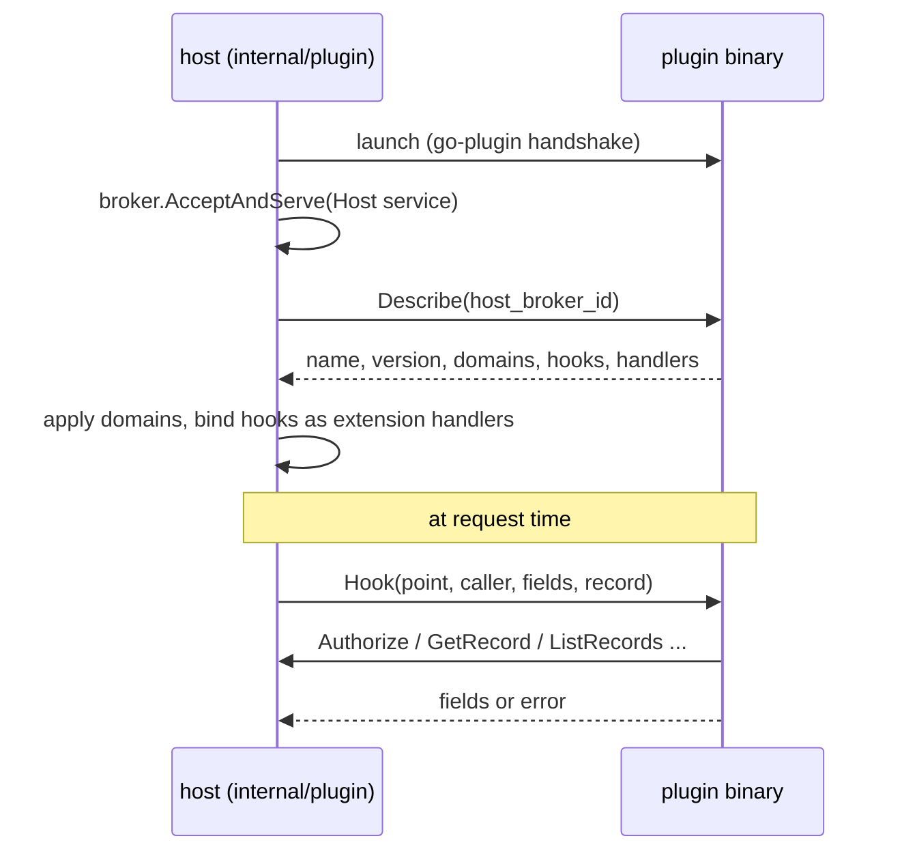

# External Go apps (gRPC + go-plugin)

External apps are separate Go binaries that the host launches with [HashiCorp go-plugin](https://github.com/hashicorp/go-plugin) and talks to over [gRPC](https://grpc.io/). They exist for one reason: **Go code** (hooks and handlers) that is not compiled into the host. Everything else an external app needs — domain definitions, data, install, policies — is also reachable over GraphQL, so the CLI can do it too ([Architecture](architecture.md)).

| Lane | Audience | Mechanism |
|------|----------|-----------|
| North–south | React SPA, in-web CLI, native CLI | GraphQL `/graphql` |
| In-process east–west | Compiled-in apps | `host.Provide` / `Lookup`, `extension.Register` |
| Out-of-process east–west | External Go apps | gRPC over go-plugin (`internal/plugin`, `packages/sdk-go/plugin`) |

The UI and the CLI never speak gRPC.

## What an external app can do

1. **Provide domain definitions** — `app.yaml` documents applied through the dynamic-domain path (source `plugin:<name>`). Same validation and additive DDL as `platformApplyDomain`.
2. **Register Go hooks** — on any model lifecycle point, including wildcards and other apps' models (`model.<app>.<model>.beforeCreate`, `model.*.*.afterUpdate`, …). Before-hooks may change `Fields` or reject the write; after-hooks are fire-and-log.
3. **Implement handlers** — queries/commands declared without `list`/`get`/`create`/`update`/`delete` shorthand.
4. **Call platform services from hooks/handlers** through the host broker.

## Contract

Protobuf: [`packages/sdk-go/plugin/proto/plugin.proto`](https://github.com/xerxesar/kaizengo/blob/main/packages/sdk-go/plugin/proto/plugin.proto) (package `kaizengo.plugin.v1`). Regenerate with `make proto` (needs `protoc`, `protoc-gen-go`, and `protoc-gen-go-grpc` on `PATH`). Fields, records, handler args, and results travel as JSON bytes, so values have the same shape GraphQL clients see. The go-plugin handshake (`plugin.Handshake`, protocol version 1) must match between host and plugin.



**`Plugin` service** (implemented by the plugin, called by the host)

| RPC | Purpose |
|-----|---------|
| `Describe` | Manifest: name, version, domain documents, hook bindings (`point`, `priority`), handler bindings (`app`, `kind`, `name`) |
| `Hook` | Run one bound hook; returns replacement `fields` (before-hooks) or an `error` message |
| `Handle` | Run a query/command handler; returns a JSON-compatible `result` or `error` |

**`Host` service** (implemented by the host, dialed by the plugin through the go-plugin broker)

| RPC | Purpose |
|-----|---------|
| `ApplyDomain` / `GetDomain` | Domain API (same as `platformApplyDomain` / `platformDomain`); a complete document for any app, compiled apps included |
| `Authorize` | ACL/policy evaluation for a caller (`allowed`, readable/writable fields) |
| `Principal` | Caller's roles in the org |
| `GetRecord` / `ListRecords` / `CreateRecord` / `UpdateRecord` / `DeleteRecord` | Business data through the engine (hooks, validation, ACL). Set `system: true` to bypass ACL for trusted background work |

Every hook/handler request carries a `Caller` (`org_id`, `user_id`). Plugins pass it back on host calls so ACL is evaluated as that user. Plugins are trusted local binaries started by the host; the broker is not exposed on any network port.

In the SDK, `HookCtx` and `HandlerCtx` are both a `context.Context` and a `plugin.Call`, so they are passed straight to `Host` methods (`c.Host.ListRecords(c, …)`). `c.Host.AsSystem()` returns a client whose record calls set `system: true`. Host calls are allowed from inside a hook; a before-hook can read other records before deciding.

Log through `plugin.Log` (hclog, JSON on stderr). The host keeps its levels; plain stderr lines are logged at debug level.

## Writing an external app

```go
package main

import "kaizengo/packages/sdk-go/plugin"

const domain = `
name: notes
title: Notes
summary: Notes managed by an external Go app
models:
  - name: note
    fields:
      - { name: title, type: string, required: true }
      - { name: body, type: text }
queries:
  - { name: notes, list: note }
  - name: noteCount
    returns: int
commands:
  - { name: addNote, create: note }
`

func main() {
	plugin.Serve(&plugin.App{
		Name:    "notes-plugin",
		Version: "0.1.0",
		Domains: []string{domain},
		Hooks: []plugin.Hook{{
			Point: "model.notes.note.beforeCreate",
			Fn: func(c *plugin.HookCtx) error {
				c.Fields["title"] = strings.TrimSpace(fmt.Sprint(c.Fields["title"]))
				return nil
			},
		}},
		Handlers: []plugin.Handler{{
			App: "notes", Kind: plugin.Query, Name: "noteCount",
			Fn: func(c *plugin.HandlerCtx) (any, error) {
				rows, err := c.Host.ListRecords(c, "notes", "note")
				return len(rows), err
			},
		}},
	})
}
```

A runnable version lives in [`plugins/notes`](https://github.com/xerxesar/kaizengo/tree/main/plugins/notes). It also rejects duplicate titles from the before-hook, logs every create through a wildcard after-hook, and implements a `pinNote` command that checks `Authorize` before `UpdateRecord`.

## Running

```bash
make plugins                                   # → bin/plugins/notes
KaizenGo_PLUGINS=./bin/plugins/notes ./bin/server
```

`KaizenGo_PLUGINS` is a comma-separated list of plugin binaries. On each platform build (database activation) the host:

1. Launches every binary and performs the go-plugin handshake.
2. Calls `Describe`, applies the plugin's domain documents (a no-op when unchanged), and binds its hooks and handlers.
3. Unbinds hooks and handlers and kills the plugin processes on platform shutdown.

A plugin that fails to start, describe, or apply its domains is logged, unbound, and listed with its `error`; other plugins and the platform keep running. Handlers of a stopped plugin answer with "has no handler".

Inspect loaded plugins with the `platformPlugins` GraphQL query (resource `platform.api.plugins`) or `plugins` in the CLI.

```text
› plugins
name          version  apps   hooks                                            handlers                                      error
notes-plugin  0.1.0    notes  model.notes.note.beforeCreate, model.*.*.after…  query notes.noteCount, command notes.pinNote
```

## Non-goals

- gRPC for the SPA or the CLI
- Exposing go-plugin endpoints on the public HTTP port
- Cross-app SQL from plugins (use the `Host` record RPCs)
- Non-Go plugin languages in v1

## Related

- [Architecture](architecture.md) — 3+1 layers, GraphQL vs gRPC
- [extension-platform.md](extension-platform.md) — in-process extension points
- [capabilities.md](capabilities.md) — `provides` / `uses`
- [graphql.md](graphql.md) — north–south API
